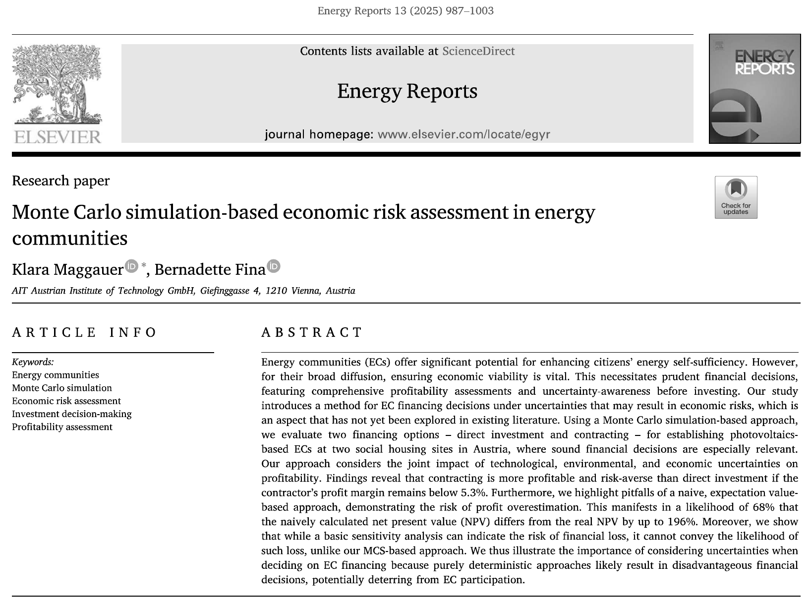
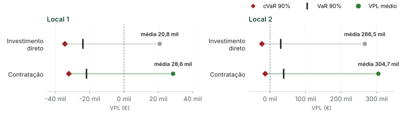
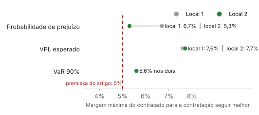
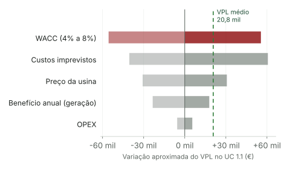

## O artigo

:::: {.columns}
::: {.column width="56%"}
{.print-artigo}
:::

::: {.column width="3%"}
:::

::: {.column width="41%"}
::: {.ficha}
[Título original]{.rotulo}
Monte Carlo simulation-based economic risk assessment in energy communities

[Autoras]{.rotulo}
Klara Maggauer e Bernadette Fina (AIT Austrian Institute of Technology, Viena)

[Periódico]{.rotulo}
*Energy Reports*, v. 13, p. 987-1003, 2025 (Elsevier, acesso aberto)

[DOI]{.rotulo}
[10.1016/j.egyr.2024.12.046](https://doi.org/10.1016/j.egyr.2024.12.046)

[Tramitação]{.rotulo}
Recebido em 19/6/2024, aceito em 16/12/2024
:::
:::
::::

[Fonte: primeira página do artigo. Licença CC BY-NC 4.0.]{.fonte}

::: {.notes}
A ficha do artigo. São duas autoras do AIT, o instituto austríaco de tecnologia, publicado em 2025 na Energy Reports, da Elsevier, em acesso aberto. É um artigo recente, recebido em junho e aceito em dezembro de 2024. As palavras-chave resumem o caminho: comunidades de energia, simulação de Monte Carlo e avaliação de risco econômico.
:::

## Contexto: comunidades de energia

::: {.kpis .compacto}
::: {.kpi}
[2019]{.num}
[pacote europeu *Clean Energy for all Europeans* cria as comunidades de energia na lei]{.rot}
:::
::: {.kpi}
[Vizinhos]{.num}
[geram energia solar juntos e dividem o que produzem]{.rot}
:::
::: {.kpi .cinza}
[Pessoas físicas]{.num}
[fundam a maioria delas, com pouco capital disponível]{.rot}
:::
:::

 

[Com pouco dinheiro e muitos donos, **a forma de financiar** passa a ser uma decisão crítica.]{.frase}

[Fonte: Maggauer e Fina (2025), seção 1; Gjorgievski et al. (2021); Hanke e Lowitzsch (2020).]{.fonte}

::: {.notes}
Um pouco de contexto, porque o tema é pouco comum aqui no Brasil. Desde 2019, a União Europeia reconhece em lei as comunidades de energia: grupos de moradores que instalam, por exemplo, painéis solares nos telhados e dividem a energia gerada. Elas aumentam a autossuficiência e podem reduzir a pobreza energética. Só que a maioria é fundada por pessoas físicas, com pouco capital. Por isso a decisão de como financiar a usina pesa tanto. É aí que o artigo entra.
:::

## O problema e a lacuna

:::: {.columns}
::: {.column width="48%"}
[O que a literatura já faz]{.rotulo}

- Calcula a **rentabilidade** com valores fixos: um só VPL, como se preço, taxa e geração fossem certos
- Trata a **incerteza** na operação e no planejamento técnico
- Usa quase sempre **otimização**, pouco Monte Carlo
:::

::: {.column width="4%"}
:::

::: {.column width="48%"}
[O que ninguém fez]{.rotulo}

::: {.cartoes}
::: {.cartao .alerta}
**Lacuna**
Comparar **formas de financiamento** medindo quanto o VPL de cada uma pode variar, e a chance de prejuízo.
:::
:::

[Risco de perda e retorno baixo afastam moradores das comunidades (Guetlein e Schleich, 2023; Woo et al., 2019).]{.pequeno .suave}
:::
::::

[Fonte: Maggauer e Fina (2025), seção 2.5.]{.fonte}

::: {.notes}
As autoras organizam a literatura em três frentes. Há muitos estudos sobre rentabilidade das comunidades, mas todos calculam com valores fixos: um preço da usina, uma taxa de desconto, uma geração de energia. O resultado é um único VPL, como se esses valores fossem certos, sem considerar que podem variar. Há estudos com incerteza, mas sobre a operação do dia a dia ou sobre qual tecnologia instalar. E quase todos usam otimização. A lacuna é esta: ninguém comparou formas de financiamento olhando para o risco. E isso importa, porque a literatura mostra que o medo de perder dinheiro afasta os moradores dessas comunidades.
:::

## Objetivo do estudo

[Propor um método baseado em **simulação de Monte Carlo** para escolher a **forma de financiamento** de uma comunidade de energia solar, considerando **rentabilidade e risco**.]{.frase}

::: {.passos}
- Medir o efeito conjunto de incertezas técnicas, ambientais e econômicas sobre o VPL
- Aplicar a dois conjuntos de habitação social na Áustria
- Comparar com o cálculo determinístico e com a análise de sensibilidade
:::

[Fonte: Maggauer e Fina (2025), seções 1 e 2.5.]{.fonte}

::: {.notes}
O objetivo é propor um método, com simulação de Monte Carlo, para ajudar a comunidade a escolher como financiar a usina olhando ao mesmo tempo para rentabilidade e risco. As autoras declaram três contribuições: medir o efeito conjunto das incertezas sobre o VPL, aplicar o método a dois casos reais de habitação social, e comparar com o que se faria sem Monte Carlo, ou seja, o cálculo determinístico e a análise de sensibilidade.
:::

## Referencial I: rentabilidade e financiamento

::: {.cartoes .c2}
::: {.cartao}
**Compartilhar compensa**
Dividir a usina sai mais barato que o uso individual: custos rateados, mais área, sinergia.
[Fina et al. (2019); Radl et al. (2020); D'Adamo et al. (2023)]{.ref}
:::
::: {.cartao}
**Quem financia**
A maioria dos projetos usa investidores locais. Terceiros aparecem em contextos de baixa renda.
[Reis et al. (2021); Cielo et al. (2021); Iazzolino et al. (2022)]{.ref}
:::
::: {.cartao}
**Contratação é rentável**
Contratos de energia e de usina solar são rentáveis para moradores e para contratados.
[Monsberger et al. (2021); Fina et al. (2020b); Li e Okur (2023)]{.ref}
:::
::: {.cartao .alerta}
**O que falta**
Todos calculam um VPL único, com valores fixos. Nenhum mede quanto o resultado pode variar.
:::
:::

[Fonte: Maggauer e Fina (2025), seções 2.1, 2.2 e 2.5.]{.fonte}

::: {.notes}
O primeiro bloco do referencial trata de rentabilidade e financiamento. Os estudos mostram que compartilhar a usina compensa mais que cada um ter a sua. Sobre quem paga, a maioria dos projetos depende de investidores locais, e o financiamento por terceiros aparece mais em contextos de baixa renda, que é justamente o caso da habitação social. E a contratação, em que uma empresa instala e cobra uma parcela, já se mostrou rentável. O ponto fraco, no cartão vermelho: nenhum desses trabalhos considera incerteza.
:::

## Referencial II: incerteza e Monte Carlo

::: {.cartoes .c2}
::: {.cartao}
**Incerteza muda a decisão**
Na operação e no planejamento, ignorar incerteza leva a projetos piores. Em um caso, o custo de operação sobe até 90%.
[Jasinski et al. (2023); Prabatha et al. (2021); Tostado-Véliz et al. (2022a; 2022b); Pagnini et al. (2024)]{.ref}
:::
::: {.cartao}
**Monte Carlo para risco econômico**
Método consolidado: gera a distribuição do VPL ou da TIR, não um número só.
[Platon e Constantinescu (2014); Hacura et al. (2001); Rezaie et al. (2007)]{.ref}
:::
::: {.cartao}
**Aplicações em energia**
Eólica, cogeração, geradores, eficiência energética, portfólio de geração.
[Montes et al. (2011); Colantoni et al. (2021); Zaroni et al. (2019); Zheng et al. (2019)]{.ref}
:::
::: {.cartao}
**Riscos de energia renovável**
Dependem de país, tecnologia e regulação. Prêmio de risco da energia solar está caindo.
[Ioannou et al. (2017); Egli (2020)]{.ref}
:::
:::

[Fonte: Maggauer e Fina (2025), seções 2.3 e 2.4.]{.fonte}

::: {.notes}
O segundo bloco trata de incerteza. Vários estudos mostram que, na operação e no planejamento dessas comunidades, ignorar a incerteza leva a decisões piores; num deles, o custo de operação sobe até 90%. Em paralelo, o Monte Carlo é um método consolidado para risco econômico: em vez de um VPL, ele entrega a distribuição inteira de VPLs possíveis. Já foi aplicado em eólica, cogeração, eficiência energética. A ponte que falta, segundo as autoras, é juntar as duas coisas na escolha do financiamento.
:::

## Referencial III: como medir o risco

[Três medidas, todas tiradas da distribuição simulada do VPL]{.rotulo}

::: {.cartoes .c3}
::: {.cartao}
**Probabilidade de prejuízo (RoL)**
Percentual dos cenários em que o VPL fica abaixo de zero.
:::
::: {.cartao}
**VaR 90% (*value at risk*)**
Valor que separa os 10% piores cenários: só 10% ficam abaixo dele.
:::
::: {.cartao}
**cVaR 90% (*conditional VaR*)**
Média dos 10% piores cenários. Mostra o tamanho da perda quando dá errado.
:::
:::

 

[Exemplo do artigo, investimento direto no local 1]{.rotulo}

::: {.kpis .compacto}
::: {.kpi}
[20,8 mil €]{.num}
[VPL médio]{.rot}
:::
::: {.kpi .cinza}
[32,4%]{.num}
[probabilidade de prejuízo]{.rot}
:::
::: {.kpi .cinza}
[−24,0 mil €]{.num}
[VaR 90%]{.rot}
:::
::: {.kpi .cinza}
[−34,5 mil €]{.num .vermelho}
[cVaR 90%]{.rot}
:::
:::

[Fonte: Maggauer e Fina (2025), seção 3.3 (Eq. 16) e Tabela 6.]{.fonte}

::: {.notes}
Antes dos resultados, as três medidas de risco, porque elas aparecem o tempo todo. A probabilidade de prejuízo é simplesmente a fração dos cenários com VPL negativo. O VaR a 90% é o valor que separa os 10% piores cenários. O cVaR é a média desses 10% piores, ou seja, quanto se perde, em média, quando as coisas dão errado. No exemplo do artigo: o projeto tem VPL médio positivo de 20,8 mil euros, mas em um terço dos cenários dá prejuízo, e nos 10% piores a perda média é de 34,5 mil. É essa informação que um VPL único esconde.
:::

## Os casos e as duas formas de financiar

:::: {.columns}
::: {.column width="46%"}
| | Local 1 | Local 2 |
|:--|--:|--:|
| Cidade | Viena | Eisenstadt |
| Apartamentos | 118 | 469 |
| Demanda anual | 250 MWh | 1.270 MWh |
| Potência solar | 252 kWp | 1.209 kWp |
| Autossuficiência | 33% | 35% |

[Habitação social: recursos limitados.]{.pequeno .suave}
:::

::: {.column width="4%"}
:::

::: {.column width="50%"}
::: {.cartoes}
::: {.cartao}
**Investimento direto**
Moradores pagam a usina à vista e arcam com operação, seguros e imprevistos.
:::
::: {.cartao}
**Contratação**
Uma empresa financia e cobra parcela fixa por 13 anos: anuidade do investimento, operação e margem de lucro. Depois a usina passa para a comunidade.
:::
:::
:::
::::

[Fonte: Maggauer e Fina (2025), seção 3.1, Tabelas 1 e 2.]{.fonte}

::: {.notes}
Os dois casos são conjuntos de habitação social na Áustria. O local 1 fica em Viena, com 118 apartamentos e uma usina de 252 quilowatts-pico. O local 2 fica em Eisenstadt, com 469 apartamentos e uma usina quase cinco vezes maior. Em cada local, duas formas de financiar. No investimento direto, os moradores pagam a usina à vista e assumem todos os custos e riscos. Na contratação, uma empresa financia e cobra uma parcela fixa por 13 anos, que inclui a margem de lucro dela; depois disso, a usina é da comunidade. Isso gera quatro casos, que o artigo chama de UC 1.1, 1.2, 2.1 e 2.2.
:::

## O modelo de VPL

::: {.formula .menor}
$$VPL = \sum_{t=0}^{T}\frac{B_t - C_t}{(1+WACC)^t}$$
:::

:::: {.columns}
::: {.column width="48%"}
[Benefícios (iguais nas duas formas)]{.rotulo}

- Conta de luz evitada: **0,23 €/kWh**
- Venda do excedente à rede: **0,07 €/kWh**
- Geração cai linearmente até **80%** no fim da vida útil
:::

::: {.column width="4%"}
:::

::: {.column width="48%"}
[Custos]{.rotulo}

- **Direto:** investimento no ano 0, OPEX e imprevistos todo ano
- **Contratação:** parcela = (1 + margem) × anuidade + OPEX do contratado, por 13 anos; depois, OPEX e imprevistos
:::
::::

[Tarifas de rede ficaram de fora. Fonte: Maggauer e Fina (2025), seção 3.2, Equações 1 a 15.]{.fonte}

::: {.notes}
O indicador é o VPL clássico, descontado pelo WACC. Os benefícios são os mesmos nas duas formas: a conta de luz que a comunidade deixa de pagar, a 23 centavos de euro por quilowatt-hora, e a venda do excedente à rede, a 7 centavos. A geração cai linearmente até 80% da potência original no fim da vida útil. O que muda são os custos. No investimento direto, paga-se tudo no ano zero e depois operação e imprevistos. Na contratação, paga-se a parcela fixa por 13 anos e só depois a comunidade assume operação e imprevistos. Um detalhe que vale guardar: tarifas de rede ficaram de fora.
:::

## As incertezas do modelo

| Parâmetro | Faixa | Distribuição |
|:--|:--|:--|
| Vida útil da usina | 25 a 35 anos (moda 30) | gama |
| Preço da usina | 1.000 a 1.200 €/kWp (moda 1.100) | gama |
| WACC nominal | 4% a 8% | uniforme |
| OPEX | 16 a 19 €/kWp ao ano | uniforme |
| Custos imprevistos | 0% a 2,5% do CAPEX ao ano (moda 1,5%) | beta |
| Benefício anual | 116 a 128 €/kWp (local 1); 126 a 136 €/kWp (local 2) | gama |

[Fixos: demanda, tarifas de energia, prazo do contrato (13 anos). Margem do contratado: 5%, sem dado de mercado.]{.pequeno .suave}

[Fonte: Maggauer e Fina (2025), Tabelas 3 e 4 e seção 3.5.]{.fonte}

::: {.notes}
Aqui estão os seis parâmetros incertos. A regra das autoras foi usar a distribuição mais simples que respeitasse os dados: gama para o que não pode ser negativo, como vida útil e preço; beta para o que fica entre zero e um, como a taxa de imprevistos; e uniforme quando a fonte só dava uma faixa, que é o caso do WACC e do OPEX. Ficaram fixos a demanda, as tarifas e o prazo do contrato. E a margem do contratado foi fixada em 5%, sem dado de mercado. Esse 5% vai ser importante daqui a pouco.
:::

## Monte Carlo em 7 passos

::: {.passos}
- Identificar os parâmetros incertos que afetam o VPL
- Escolher uma distribuição de probabilidade para cada um
- Sortear um valor de cada distribuição
- Calcular o VPL com os valores sorteados
- Repetir **100 mil vezes** por caso
- Montar o histograma dos VPLs
- Calcular média, desvio-padrão, RoL, VaR e cVaR
:::

[Implementado em Python. Fonte: Maggauer e Fina (2025), seção 3.3.]{.fonte}

::: {.notes}
O Monte Carlo em si é simples. Escolhem-se os parâmetros incertos e uma distribuição para cada um. Aí se sorteia um valor de cada, calcula-se o VPL, e repete-se isso cem mil vezes. No fim, há cem mil VPLs possíveis, que viram um histograma, e dele saem a média e as medidas de risco. A ideia central é trocar a pergunta "qual é o VPL?" por "qual é a distribuição do VPL?".
:::

## Resultado 1: contratação x investimento direto

{width="100%"}

::: {.kpis}
::: {.kpi .cinza}
[32,4% → 28,6%]{.num}
[probabilidade de prejuízo no local 1, direto → contratação]{.rot}
:::
::: {.kpi}
[6,2% → 5,4%]{.num}
[probabilidade de prejuízo no local 2, direto → contratação]{.rot}
:::
:::

[Fonte: Maggauer e Fina (2025), Tabelas 6 e 7. Margem do contratado de 5%.]{.fonte}

::: {.notes}
Primeiro resultado. Cada linha mostra a média do VPL, o VaR e o cVaR de um caso. Nos dois locais, a contratação tem média maior e cauda menos ruim. No local 1, a probabilidade de prejuízo cai de 32 para 29%; no local 2, de 6,2 para 5,4%. A explicação das autoras é que, durante os 13 anos do contrato, a parcela é fixa e a comunidade não paga imprevistos, o que reduz a incerteza de custo. E o local 2 vai melhor nas duas formas porque tem mais sol e mais autossuficiência.
:::

## Resultado 2: o limite da margem do contratado

:::: {.columns}
::: {.column width="62%"}
{width="100%"}
:::

::: {.column width="38%"}
::: {.kpis}
::: {.kpi}
[≤ 5,3%]{.num}
[margem para a contratação ser melhor em lucro **e** em risco nos dois locais]{.rot}
:::
:::

[A margem não só desloca a distribuição para a esquerda: ela **alarga a cauda** de perdas.]{.pequeno}
:::
::::

[Fonte: Maggauer e Fina (2025), seção 4.3, Tabela 8 e Figuras 7 e 8.]{.fonte}

::: {.notes}
Como não há dado público sobre margem de contratos de energia solar, as autoras variaram essa margem. O gráfico mostra até onde a contratação continua melhor, por critério. Pelo VPL médio, aguenta margens de até 7,6 ou 7,7%. Pelo VaR, até 5,6%. E pela probabilidade de prejuízo, até 6,7% no local 1, mas só 5,3% no local 2. Juntando tudo, a recomendação é negociar a margem para ficar em até 5,3%. Um detalhe interessante: aumentar a margem não só desloca a distribuição, mas alarga a cauda das perdas.
:::

## Resultado 3: Monte Carlo x ingênuo x sensibilidade

:::: {.columns}
::: {.column width="52%"}
| | VPL médio (Monte Carlo) | VPL ingênuo | Percentil |
|:--|--:|--:|--:|
| UC 1.1 | 20.800 € | 18.200 € | 50,34 |
| UC 1.2 | 266.500 € | 252.900 € | 50,56 |
| UC 2.1 | 28.600 € | 25.900 € | 50,37 |
| UC 2.2 | 304.700 € | 289.900 € | 50,24 |

[O cálculo ingênuo acerta o **centro** (a mediana), mas não diz nada sobre o risco.]{.pequeno}
:::

::: {.column width="4%"}
:::

::: {.column width="44%"}
[Sensibilidade, um fator por vez]{.rotulo}

::: {.passos}
- Benefício anual (geração)
- Preço da usina
- WACC
:::

[Mostra que o VPL **pode** ficar negativo, mas não **com que probabilidade**.]{.pequeno .suave}
:::
::::

[Fonte: Maggauer e Fina (2025), Tabelas 10 e 11 e Figuras 9 e 10.]{.fonte}

::: {.notes}
O terceiro resultado compara o Monte Carlo com o que se faria sem ele. O cálculo ingênuo, com cada parâmetro no seu valor central, dá um VPL de 5 a 12% abaixo da média simulada e cai praticamente na mediana da distribuição. Ou seja, ele acerta o centro, mas não diz nada sobre risco: no local 1, a probabilidade de prejuízo passa de 28%. A análise de sensibilidade avança um pouco: mostra que o benefício anual é o fator mais influente, seguido do preço da usina e do WACC, e que o VPL pode ficar negativo. Mas não diz com que probabilidade. Esse é o argumento central das autoras a favor do Monte Carlo.
:::

## Um olhar estatístico sobre os resultados

:::: {.columns}
::: {.column width="50%"}
{width="100%"}

[Inclinações da Figura 9a × faixas da Tabela 3. Aproximação linear, um fator por vez.]{.pequeno .suave}
:::

::: {.column width="50%"}
::: {.cartoes}
::: {.cartao .alerta}
**Conclusão no fio da navalha**
Premissa de margem: 5%. Limite no local 2: 5,3%. Folga de 0,3 ponto sobre um número sem dado de mercado.
:::
::: {.cartao}
**Os “68%” supõem normalidade**
A regra de um desvio-padrão vale para a normal. Os histogramas são assimétricos e achatados.
:::
::: {.cartao}
**O risco depende da taxa sorteada**
Só a faixa de 4% a 8% do WACC move o VPL do UC 1.1 em ±55,6 mil €, contra média de 20,8 mil €.
:::
:::
:::
::::

[Cálculos próprios com dados das Tabelas 3, 8 e 10 e da Figura 9. Script em `scripts/graficos.py`.]{.fonte}

::: {.notes}
Aqui entra a minha leitura como estatístico, com contas feitas a partir dos números do próprio artigo. Primeiro: a conclusão principal está no fio da navalha. A premissa de margem é 5%, sem dado de mercado, e no local 2 a contratação deixa de ser menos arriscada a partir de 5,3%. Segundo: o resumo diz que há 68% de chance de o VPL real diferir do ingênuo em até 196%. Esse 68% é a regra do desvio-padrão da distribuição normal, e os histogramas do artigo não são normais. Terceiro, o gráfico: multiplicando a inclinação de cada fator pela faixa usada na simulação, as maiores alavancas do VPL são o WACC e os imprevistos, que são premissas, e não a geração solar. Só não saber se a taxa é 4 ou 8% já move o VPL em 55 mil euros, quase três vezes a média. Parte do risco medido é, na verdade, incerteza sobre qual taxa usar.
:::

## O que faltou

:::: {.columns}
::: {.column width="48%"}
[No referencial teórico]{.rotulo}

::: {.cartoes}
::: {.cartao}
**Clássicos de finanças ausentes**
Hertz (1964), que levou o Monte Carlo para o orçamento de capital, não é citado.
:::
::: {.cartao}
**Medidas de risco sem base teórica**
VaR e cVaR sem Artzner et al. (1999) nem Rockafellar e Uryasev (2000).
:::
::: {.cartao}
**Sem opções reais**
O contrato tem flexibilidade (prazo, renegociação) que Dixit e Pindyck (1994) ajudariam a valorar.
:::
:::
:::

::: {.column width="4%"}
:::

::: {.column width="48%"}
[No método]{.rotulo}

::: {.cartoes}
::: {.cartao}
**Tarifa fixa por 30 anos**
Preço da energia constante e WACC nominal: na prática, supõe tarifa caindo em termos reais.
:::
::: {.cartao}
**Parâmetros independentes**
Sem correlação entre preço, taxa e custos. As autoras reconhecem.
:::
::: {.cartao}
**Difícil de reproduzir**
Dados e código não são compartilhados. Imprevistos: Tabela 3 (até 2,5%) e Figura 3b (até ~8%) não batem.
:::
:::
:::
::::

[Fonte: análise própria a partir de Maggauer e Fina (2025).]{.fonte}

::: {.notes}
O que eu acho que faltou. No referencial, as 65 referências são quase todas da área de energia. Ficam de fora os clássicos de finanças: Hertz, de 1964, que levou o Monte Carlo para a análise de investimentos; os trabalhos que dão base teórica ao VaR e ao cVaR; e a teoria de opções reais, que ajudaria a valorar a flexibilidade do contrato. No método, três pontos. A tarifa de energia fica fixa por 30 anos enquanto o desconto é por uma taxa nominal, o que equivale a supor que a tarifa cai em termos reais. Os parâmetros são tratados como independentes, o que as próprias autoras reconhecem. E o estudo é difícil de reproduzir: dados e código não são compartilhados, e a distribuição dos imprevistos na Tabela 3 não bate com a da Figura 3b.
:::

## Contribuições e agenda

:::: {.columns}
::: {.column width="48%"}
[O que fica de útil]{.rotulo}

::: {.passos}
- Leva o **risco** para a escolha do **financiamento**, não só do projeto
- Mostra o que o **VPL único esconde**: até 32% de chance de prejuízo
- Dá um critério prático: **negociar a margem** do contratado
:::
:::

::: {.column width="4%"}
:::

::: {.column width="48%"}
[Próximos passos]{.rotulo}

- **Das autoras:** correlação entre parâmetros (cópulas)
- **Das autoras:** volatilidade de preços, tarifas de rede, demanda incerta
- **Sugestão:** tratar o WACC como cenário, não como sorteio
- **Sugestão:** comparar locais por kWp instalado
:::
::::

[Fonte: Maggauer e Fina (2025), seções 5 e 6, e análise própria.]{.fonte}

::: {.notes}
Mesmo com as ressalvas, o artigo tem contribuições claras. Ele leva a análise de risco para a escolha da forma de financiar, e não só para a escolha do projeto. Mostra, com números, o que um VPL único esconde. E dá um critério prático para quem vai negociar: a margem do contratado. As autoras propõem incluir correlação entre parâmetros, volatilidade de preços e demanda incerta. Eu acrescentaria tratar o WACC como cenários separados, e não como sorteio, e comparar os locais por quilowatt-pico instalado, já que um é quase cinco vezes maior que o outro.
:::

## Mensagem final {.fim}

 

[Um VPL positivo pode esconder **um terço de chance de prejuízo**. O Monte Carlo mostra o risco, mas o resultado continua dependendo das **premissas**.]{.frase style="text-align:left; display:inline-block;"}

  

[Obrigado. Perguntas?]{style="font-size:1.3em; font-weight:600; color:#1E4D35;"}

[Felipe Luiz Fonseca]{.suave .pequeno}

::: {.notes}
Para fechar: um VPL positivo pode esconder um terço de chance de prejuízo, e o Monte Carlo é uma ferramenta acessível para enxergar isso. Mas ele não elimina o julgamento: a resposta continua dependendo das premissas, como a margem do contratado e a taxa de desconto. Obrigado, fico à disposição para perguntas.
:::

## Apêndice: parâmetros incertos (Tabela 3) {.smaller}

| Parâmetro | Mín. | Máx. | Moda | Fonte |
|:--|--:|--:|--:|:--|
| Vida útil T (anos) | 25 | 35 | 30 | Wiser et al. (2020) |
| Preço da usina (€/kWp) | 1.000 | 1.200 | 1.100 | Biermayr et al. (2023) |
| WACC nominal | 0,04 | 0,08 | sem moda | Coppitters et al. (2020) |
| OPEX (€/kWp ao ano) | 16 | 19 | sem moda | Coppitters et al. (2020) |
| Imprevistos (% do CAPEX ao ano) | 0,0 | 2,5 | 1,5 | Lorenzo et al. (2020) e outros |
| Geração local 1 (kWh/kWp) | 930 | 1.027 | 995 | PVgis, 2005 a 2020 |
| Geração local 2 (kWh/kWp) | 971 | 1.096 | 1.053 | PVgis, 2005 a 2020 |
| Benefício local 1 (€/kWp) | 116,28 | 128,37 | 123,13 | calculado |
| Benefício local 2 (€/kWp) | 125,76 | 136,25 | 133,23 | calculado |

[Fonte: Maggauer e Fina (2025), Tabela 3.]{.fonte}

::: {.notes}
Slide de apoio para perguntas sobre as premissas.
:::

## Apêndice: parâmetros fixos e resultados completos {.smaller}

:::: {.columns}
::: {.column width="40%"}
| Parâmetro fixo | Valor |
|:--|--:|
| Prazo do contrato | 13 anos |
| Tarifa de venda à rede | 0,07 €/kWh |
| Preço da energia da rede | 0,23 €/kWh |
| OPEX do contratado | 17,5 €/kWp |
| Margem do contratado | 0% a 100% (base 5%) |
| Demanda | 61 perfis reais |
:::

::: {.column width="4%"}
:::

::: {.column width="56%"}
| | UC 1.1 | UC 1.2 | UC 2.1 | UC 2.2 |
|:--|--:|--:|--:|--:|
| VPL médio (€) | 20.800 | 266.500 | 28.600 | 304.700 |
| Desvio-padrão (€) | 35.700 | 189.000 | 40.000 | 210.200 |
| RoL (%) | 32,41 | 6,20 | 28,56 | 5,4 |
| VaR 90% (€) | −24.000 | 30.100 | −21.900 | 38.400 |
| cVaR 90% (€) | −34.500 | −22.800 | −32.200 | −13.600 |
| VPL por kWp (€) | 82,5 | 220,4 | 113,5 | 252,0 |
:::
::::

[Fonte: Maggauer e Fina (2025), Tabelas 4, 6 e 7. VPL por kWp: cálculo próprio (VPL médio ÷ potência instalada).]{.fonte}

::: {.notes}
Slide de apoio. A última linha, VPL por quilowatt-pico, é conta minha, útil se perguntarem sobre a comparação entre os locais.
:::
